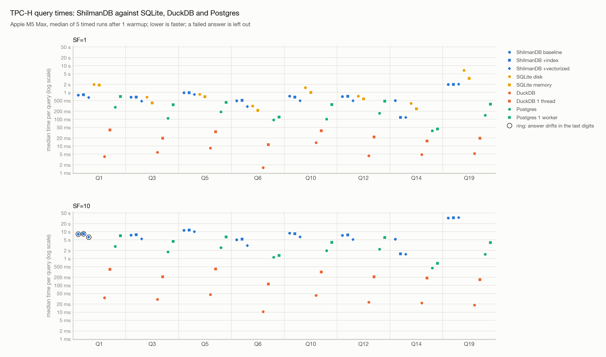

# ShilmanDB

[](https://github.com/Ashilman25/ShilmanDB/actions/workflows/ci.yml)
[](LICENSE)

A from-scratch C++17 analytics database engine, in progress, measured against SQLite, DuckDB and Postgres on TPC-H.

Numbers on this page are marked by how we know them: *measured* (we ran it), *from docs* (copied from a spec, such as TPC-H's) or *inferred* (worked out from other numbers).

## Status

**Today** ShilmanDB is a single-threaded row store. It runs 8 of the 22 TPC-H queries (8 *measured*; TPC-H has 22, *from docs*), and it has been measured on one Mac at SF=1 against SQLite, DuckDB and Postgres, and at SF=10 against DuckDB and Postgres. Every layer is written here, from page I/O up: a buffer pool, B+tree indexes, a hand-written SQL parser, a cost-based planner, and an executor that runs one row at a time, with a vectorized path that runs scans, filters, projections and aggregates a batch of rows at a time.

**What it is becoming (in progress; only a first slice of the app is built so far):**

- A columnar, parallel engine.
- One engine with two ways in: an app with a SQL runner and an AI analyst whose answers the database checks, and the Postgres protocol, so Postgres tools can connect to it.
- Running on your own data, from CSV files and from your own Postgres.

**The production bar** it is aimed at: no size limit (data bigger than memory still works), faster than Postgres on the same machine at SF=10 and SF=100, all 22 TPC-H queries, crash safety, and many users at once. A **scale ladder** measures it: SF=10, then SF=100 (about 100 GB of text, *from docs*, more than this Mac's 64 GiB of memory, *measured*), then SF=1000 on a Linux server.

The bar and the ladder are goals, not stops. A step that misses them still finishes, and the gap is reported as it is. As I put it when I set them: *"if it doesnt hit the production bar that wont be a stop just get the best we can but yes the production bars are the goals"*.

The speed goal past Postgres is DuckDB's class. DuckDB is a team's years of work, so that is the hardest bar this project has set, and today's engine is far from it (next section).

## Where it stands

<picture>
  <source media="(prefers-color-scheme: dark)" srcset="docs/images/latency-dark.png">
  
</picture>

The 8 queries are ShilmanDB's versions of TPC-H Q1, Q3, Q5, Q6, Q10, Q12, Q14 and Q19, close to the official texts but not word for word. They ran on an Apple M5 Max on 2026-11-14: 1 warmup and 5 timed runs, median, query time only (not the load). Every time and ratio in this section is *measured*. A ratio is ShilmanDB's time ÷ the other engine's, so above 1 means ShilmanDB is slower.

The headline compares ShilmanDB's headline config, `+vectorized` (8 indexes; fastest on 6 of 8 queries at SF=1 and 7 of 8 at SF=10), with `postgres` (the same 8 indexes, memory settings for a 64 GB machine, parallel workers on) and `duckdb` (its defaults, all cores, no indexes):

| `+vectorized` ÷ | SF=1, range | SF=1, geometric mean | SF=10, range | SF=10, geometric mean |
|---|---:|---:|---:|---:|
| `postgres` | 2.29-14.5 | 4.15 | 2.20-23.6 † | 3.75 † |
| `duckdb` | 24.1-385 | 99.1 | 66.4-1,836 † | 233 † |
| `sqlite_disk` | 0.30-0.98 | 0.50 | did not run | |
| `sqlite_memory` | 0.34-1.37 | 0.73 | did not run | |

† Includes Q1 at SF=10, a DRIFT result (below).

In plain words:

- **SQLite:** at SF=1 ShilmanDB is faster than SQLite on disk on all 8 queries, and faster than SQLite in memory on 5 of 8.
- **Postgres:** ShilmanDB is slower on every query, at both sizes, so the goal of beating Postgres is not met yet. Single process against single process (`postgres_1worker`), it is faster only on Q1 at both sizes and on Q12 at SF=10.
- **DuckDB:** ShilmanDB is about 99× slower at SF=1 and 233× at SF=10 (geometric means). Even DuckDB on one thread is 7.59-104× faster at SF=1.
- **Q19** is the worst query against both: it joins `lineitem` and `part`, then tests a three-branch `OR` on every joined row.
- **SF=10:** all three ShilmanDB configs ran, and every answer was checked against DuckDB and Postgres. † Q1 is a *DRIFT* result: its sums are off by up to 0.25 (2.24e-13 relative) because ShilmanDB adds decimals as doubles. Every other answer matches.

**Why the gap to DuckDB** (*inferred* from how the engines are built, not profiled): DuckDB stores columns, compressed, and reads only the columns a query uses; its loops use the CPU's vector instructions; and it uses every core. ShilmanDB reads whole rows, on one thread, through a buffer pool. The steps meant to close it:

- **14a:** a columnar file format, with exact decimal storage.
- **14b:** a parallel vectorized executor, target SF=10.
- **14c:** out-of-core execution (joins, aggregates and sorts that spill to disk), target SF=100.

**Main limits today:**

- No NULLs. Aggregates over no rows return 0.
- `LEFT JOIN` runs as an inner join, without an error.
- No functions (`extract`, `substring`, casts) and no subqueries, `DISTINCT` or `WITH`.

Every table at SF=1 and SF=10, every config of all four engines, the indexes and settings each engine got, the answer check and how to rerun it all: [docs/benchmarks.md](docs/benchmarks.md).

## Roadmap

Three tracks, in plain words. Step labels (such as 14a) are the names the code history uses.

- **Docs** (done, release `v0.1.0`): this README, the baseline above, CI and the GitHub page.
- **App:** a first slice of the app is built: a SQL runner and the AI analyst on the built-in data (6e-1, [below](#the-app)). Later the app on your own CSV and Postgres data (6e-2), a second measured check of the analyst (6d-2), and packaging as GitHub Releases and a Homebrew tap (6e-3).
- **Engine:** first the columnar core: the file format (14a), the parallel vectorized executor (14b), out-of-core execution (14c), then the switch-over once TPC-H answers match on it (14d). Then NULLs and a real `LEFT JOIN` (8b), Postgres's SQL and all 22 TPC-H queries (step 12), writes and keys (8c), importing from Postgres and CSV (10a), the Postgres wire server (9a-9d), crash safety and many users (8d, 13a-13b), and Linux, Docker and SF=1000 (10d).

Every engine step keeps TPC-H answers matching the reference and measures its speed changes. From 14b on, each one also reports its ratios to DuckDB and Postgres.

## Research results

ShilmanDB has two learned components, a join order model and an eviction policy for the buffer pool. Measured against strong classical answers, both lost or tied. Numbers in this section are *measured* unless marked otherwise; details, dates and charts are in [docs/research.md](docs/research.md).

- **The learned join optimizer ties the classical one at best.** On Q5 it once picked an order 1.8× faster than the classical planner's, but that was luck: it found that order only when the query already started with `customer` and `orders`, the way TPC-H writes it. After the classical cost formula learned to see filters, the classical planner picks that order itself. Over every connected join order of the six join queries at SF=1.0, both planners land at 1.00-1.02× of the fastest.
- **Learned eviction V2 saves no misses on TPC-H** and makes queries 3.5-6.9× slower at SF=0.01. Each eviction decision takes 16.6-17.4 µs at a 128-frame pool (about as long as 30 page reads from the file cache, *inferred*), and about 17-183 µs across pools of 128 to 2,048 frames (*from docs*).
- **The best classical eviction policy** misses 1.07-1.50× what Belady (the best possible, which needs to know the future) would, on the four pool-size and workload cells that matter at SF=1.0. That is the room a learned policy would have to win in.
- **Both learned components stay in the code, off by default.** They build only with LibTorch (`-DSHILMANDB_ENABLE_ML=ON`) and run only when asked for.

**The AI-analyst check: GO.** A local model (`gemma4-26b`, run on the Mac through MLX) turns plain-English questions into SQL, and ShilmanDB runs it. The check then tested each answer, by asking the question a second way and with evidence only the database has (such as the rows each step of the plan kept), and warned or refused when something looked wrong. The app now shows these checks beside each answer ([below](#the-app)). On 300 test questions, written by separate AI writers that never saw the checks, with the bars fixed before any model answered a test question:

- 20 of 35 silent wrong answers were warned (0.571; the bar was at least 0.50).
- 0 of 227 right answers were refused, and 18 of 227 were warned (0.079).

Said honestly, the GO is mostly "ask twice": the check that asks the question a second way and compares the answers makes 15 of the 20 catches. Without it, the other checks catch 9 of 35, which would fail the catch bar. The engine's own checks (engine traps, empty input, fan-out, grain) catch 5 of 35 on their own, but only 2 that the second phrasing and the terms check both missed. The margin is thin: at 17 of 35 the bar fails.

## The app

A first slice of the app runs on the Mac today: a SQL runner and the AI analyst on the built-in data (TPC-H at SF=0.1 and a set of product reviews). One local Python process holds the engine and the model and serves a page on `127.0.0.1` only, so nothing goes to the internet. The screen is laid out like a database tool: the tables and their columns on the left, a tab per table with its rows, and a Query tab where you ask in plain English or type SQL. Typed SQL is checked for the engine's known traps before it runs. A question goes through the same model and checks as the test above, and the verdict lands beside the answer.

The test's rates belong to the setup that was tested: that model, those files and today's engine. The app shows them only while all of that still matches. A question re-asked with a different reading of a term says it isn't part of the test, and SQL you type or edit shows no rates at all. When the columnar core changes the engine, the rates hide until the test is rerun on it.

A prompt cache keeps the model's state after the long start every prompt shares. A replay of the 300 test questions with the cache gave the same output on all 300, so the cache is on: the median wait for the first answer went from 2.51 to 1.50 s, and for the verdict from 5.29 to 3.32 s (*measured*).

```bash
cmake --build build --target analyst_bridge   # the engine bridge, from the Release build below
.venv-ai/bin/python -m app                      # prints a link and opens the browser
```

It needs the analyst check's dataset files, a `.venv-ai` with MLX and the model in the Hugging Face cache, and about 16 GB of free memory (*inferred* from the model's peak). `--no-model` runs the SQL runner alone. The flags, the files and how to rebuild the page are in [app/README.md](app/README.md).

## How it's built

SQL string → lexer → parser (AST) → planner (physical plan) → executor (iterator tree) → buffer pool → disk manager → file on disk.

| Layer | Directory | What it does |
|---|---|---|
| Storage | `src/storage/` | 8 KB page I/O, slotted pages, heap files |
| Buffer | `src/buffer/` | buffer pool with pin counts; LRU (default), CLOCK, LRU-2, ARC, LIRS and the learned policies |
| Index | `src/index/` | B+tree with point lookups and range scans |
| Catalog | `src/catalog/` | schemas, indexes and per-column statistics |
| Parser | `src/parser/` | hand-written lexer and recursive-descent parser |
| Planner | `src/planner/` | join order search, filtered row estimates, scan costs |
| Executor | `src/executor/` | row-at-a-time operators, plus a vectorized path |
| Engine | `src/engine/` | the `Database` class: `ExecuteSQL()`, `LoadTable()` |

More in [docs/architecture.md](docs/architecture.md).

## Build, test, run one query

You need macOS on Apple Silicon (the main target), CMake 3.24 or newer, Ninja, a C++17 compiler, git, and Python 3.12 or newer for the Python tests (the pinned `scipy` needs it; I use 3.14). The first configure downloads googletest, and the data step clones TPC-H's `dbgen`, so both need the network.

**Debug build and the C++ tests.** Generate the small TPC-H data before running `ctest`: the tests that check TPC-H answers skip without it.

```bash
# Debug: asserts on, no ML, no bench tools
cmake -S . -B build-debug -G Ninja -DCMAKE_BUILD_TYPE=Debug -DSHILMANDB_BUILD_BENCH=OFF
cmake --build build-debug

# TPC-H data at SF=0.01, into bench/tpch_data/sf0.01/ (builds dbgen in /tmp/tpch-dbgen the first time)
bash bench/tpch/generate_tpch_data.sh 0.01

# Run ctest from inside the build folder
cd build-debug && ctest -j 12 --output-on-failure && cd ..
```

On a fresh copy of the repo, 929 of the 930 Debug tests pass and 1 skips (*measured*): `EvictionSimTest.V2ExportedWeightsMatchTorch`, which needs the exported V2 weights file, not checked in. The `SqliteComparisonTest` tests check each of the 8 queries' answers at SF=0.01 against fixed expected results.

**Release build with the bench tools.** Use this one for any timing.

```bash
cmake -S . -B build -G Ninja -DCMAKE_BUILD_TYPE=Release -DSHILMANDB_BUILD_BENCH=ON
cmake --build build

# The 4 NextBeforeInitAsserts tests check assert(), which Release compiles out
cd build && ctest -j 12 --output-on-failure -E NextBeforeInitAsserts && cd ..
```

On the fresh copy, 925 of the 926 pass and the same `V2ExportedWeightsMatchTorch` test skips (*measured*).

**Run the TPC-H queries.** `load_tpch` loads the data into a database file and builds the 8 indexes. Then it runs the 8 queries: one untimed warmup pass, then 5 timed runs of each. It has no flag for a single query; the query texts are in [bench/tpch/tpch_workload.hpp](bench/tpch/tpch_workload.hpp). It adds to an existing database file, so start from a fresh one.

```bash
rm -f /tmp/shilmandb_sf0.01.db
./build/bench/load_tpch --sf 0.01 --db-file /tmp/shilmandb_sf0.01.db --data-dir bench/tpch_data/sf0.01/
```

It takes under a second at SF=0.01 (*measured*). For each run it prints the time, row count and buffer pool counts, and it ends with `=== 8/8 TPC-H queries passed ===`, which means every query ran without an error. It does not check answers; the tests above and the benchmark runner do.

Options: `--warmup 0 --runs 1` runs each query once. `--execution-mode vectorized` uses the vectorized path. `--eviction-policy lirs` (also `clock`, `lru2`, `arc`) picks another eviction policy. `--results-dir <folder>` writes each query's result and timings as CSV files.

**The Python tests** (the bench tools and their analysis scripts) run in a virtual environment at `.venv/`. Tests that need something not in `requirements.txt` (Postgres, LibTorch, a trained model) skip.

```bash
python3 -m venv .venv
.venv/bin/pip install -r requirements.txt
.venv/bin/python -m pytest bench -q -W error
```

On a fresh copy with only `requirements.txt` installed: 1,376 passed and 23 skipped, in 42 seconds (*measured*). Run it after the Release build: some tests drive the `build/bench/` tools and skip without them.

The full benchmark against SQLite, DuckDB and Postgres is in [docs/benchmarks.md](docs/benchmarks.md#how-to-reproduce).

## Training the learned models

The learned flags (`--use-learned-join`, `--use-learned-eviction`) need trained models. They are not checked in or attached to releases, because a TorchScript model only loads with the LibTorch version it was saved with. Train them yourself:

**1. Build with LibTorch.** The setup script downloads LibTorch 2.11.0 for macOS ARM into `third_party/libtorch/`. The ML build also needs `libomp`.

```bash
bash scripts/setup_libtorch.sh
brew install libomp
sudo mkdir -p /opt/llvm-openmp/lib
sudo ln -sf /opt/homebrew/opt/libomp/lib/libomp.dylib /opt/llvm-openmp/lib/libomp.dylib

cmake -S . -B build -G Ninja -DCMAKE_BUILD_TYPE=Release -DSHILMANDB_ENABLE_ML=ON -DSHILMANDB_BUILD_BENCH=ON
cmake --build build

# PyTorch in the venv must match LibTorch's version
.venv/bin/pip install torch==2.11.0
```

**2. The join order model** (`ml/join_optimizer/`). The data step runs `build/bench/generate_join_training_data` on every `bench/tpch_data/sf*/` folder that has data.

```bash
bash bench/tpch/generate_tpch_data.sh 0.01 0.1 1.0
.venv/bin/python ml/join_optimizer/generate_training_data.py --perturbations 80
.venv/bin/python ml/join_optimizer/train_join_model.py --model-variant wide --lr 1e-3 --batch-size 64 \
    --epochs 300 --lr-schedule cosine --patience 50
.venv/bin/python ml/join_optimizer/export_model.py      # writes ml/join_optimizer/models/join_order_model.pt
.venv/bin/python ml/join_optimizer/evaluate_join_model.py
```

**3. Eviction V2** (`ml/eviction_policy/`), trained on synthetic page-access traces:

```bash
.venv/bin/python ml/eviction_policy/generate_multiscale_traces.py
.venv/bin/python ml/eviction_policy/generate_feature_training_data.py
.venv/bin/python ml/eviction_policy/train_eviction_model_v2.py
.venv/bin/python ml/eviction_policy/export_model_v2.py   # writes ml/eviction_policy/models/eviction_model_v2.pt
.venv/bin/python ml/eviction_policy/evaluate_eviction_model_v2.py
```

**4. Run with them:**

```bash
rm -f /tmp/shilmandb_sf0.01.db
./build/bench/load_tpch --sf 0.01 --db-file /tmp/shilmandb_sf0.01.db --data-dir bench/tpch_data/sf0.01/ \
    --use-learned-join --join-model-path ml/join_optimizer/models/join_order_model.pt \
    --use-learned-eviction --eviction-model-path ml/eviction_policy/models/eviction_model_v2.pt
```

## Contributing and history

- [CONTRIBUTING.md](CONTRIBUTING.md): conventions, how to measure a speed change, and the checks every change must pass.
- [CHANGELOG.md](CHANGELOG.md): what changed, by pull request.
- [docs/benchmarks.md](docs/benchmarks.md), [docs/research.md](docs/research.md), [docs/architecture.md](docs/architecture.md): the detail behind this page.

## License

Apache-2.0. See [LICENSE](LICENSE).
