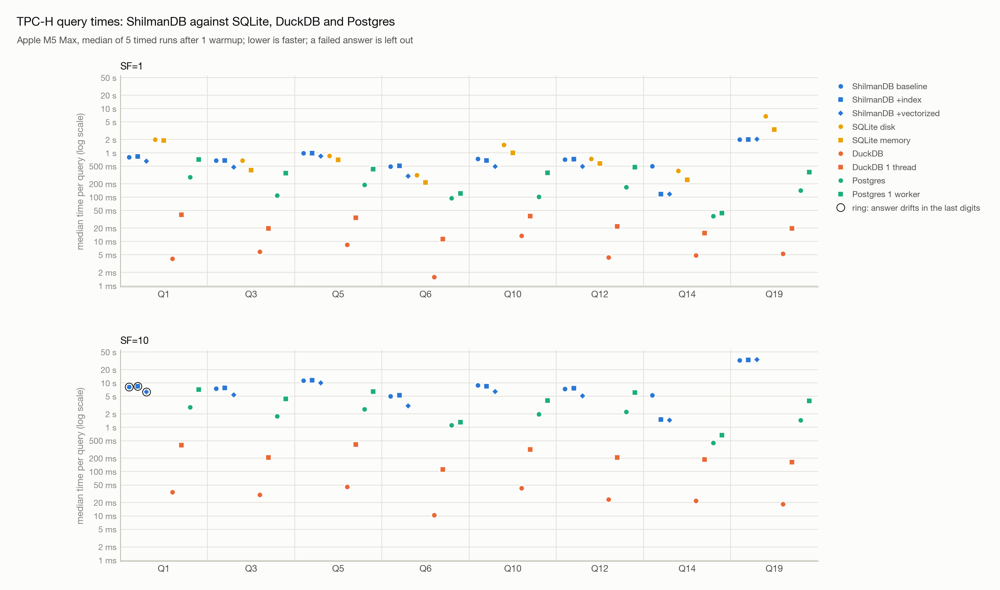
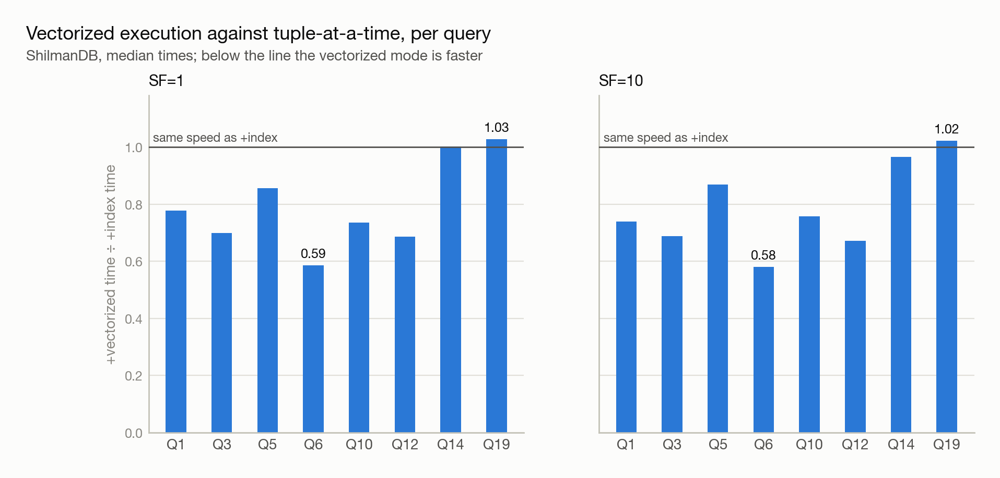

# Benchmarks

This page has ShilmanDB's query times against SQLite, DuckDB and Postgres. All four ran the same 8 TPC-H queries on one Mac on 2026-11-14. It covers how they were run, every time at SF=1 and SF=10, and how to run them again.

The ShilmanDB measured here is today's engine: a single-threaded row store. These numbers are the starting point that later work on the engine is compared with. The engine's design is in [architecture.md](architecture.md).

Numbers are marked by how we know them: *measured* (we ran it), *from docs* (copied from a spec or project notes) or *inferred* (worked out from other numbers). Every time and ratio in the result tables is *measured*: a time is the median of the measured runs, and a ratio divides two of those medians.

## Summary

- **Against SQLite (SF=1):** `+vectorized` beats SQLite on disk on all 8 queries (ratio 0.30-0.98). It beats SQLite in memory on 5 of 8 and is slower on Q3, Q5 and Q6 (1.17-1.37). *measured*
- **Against Postgres:** `+vectorized` is slower than `postgres` (memory settings tuned for this machine, parallel workers on) on all 8 queries: 2.29-14.5× at SF=1 and 2.20-23.6× at SF=10. The goal of being faster than Postgres is not met yet. Against `postgres_1worker` (one process, like ShilmanDB), it is faster on Q1 at both sizes (0.92, 0.88) and on Q12 at SF=10 (0.85). *measured*
- **Against DuckDB:** `+vectorized` is 24.1-385× slower than `duckdb` at SF=1 and 66.4-1,836× slower at SF=10. Even against `duckdb_1thread` it is 7.59-104× slower at SF=1 and 7.68-208× slower at SF=10. *measured*
- **SF=10:** all three ShilmanDB configs ran at SF=10. Every answer was checked. Q1's sums come out up to 0.25 off because ShilmanDB adds decimals as doubles, so Q1 is a DRIFT result in all three configs (below). *measured*

**How to read a ratio:** ShilmanDB's time ÷ the other engine's time. Above 1 means ShilmanDB is slower; below 1 means it is faster.

## Method

### Machine and versions

| | |
|---|---|
| Machine | Apple M5 Max, 64 GiB of memory |
| OS | macOS 26.5.2 |
| Compiler | AppleClang 17.0.0, Release build |
| SQLite | 3.53.4 (Python's `sqlite3`) |
| DuckDB | 2.0.0 (Python package; it used 18 threads by default here) |
| Postgres | 17.11 (Homebrew), reached through `psycopg` 3.3.8 over a local Unix socket |
| Date, commit | 2026-11-14, `f92b7e0` |

All *measured*, recorded by the runner in [docs/data/environment_sf1.csv](data/environment_sf1.csv) and [environment_sf10.csv](data/environment_sf10.csv). The thread count is from DuckDB's own settings at run time.

### Engines and configs

| Engine | Config | What it is | Indexes |
|---|---|---|---|
| ShilmanDB | `baseline` | tuple-at-a-time, LRU buffer pool | none |
| ShilmanDB | `+index` | `baseline` plus indexes | 8 |
| ShilmanDB | `+vectorized` | `+index`, run in vectorized mode | 8 |
| SQLite | `sqlite_disk`, `sqlite_memory` | a database file on disk, and one in memory | 6 |
| DuckDB | `duckdb` | defaults, all cores | none |
| DuckDB | `duckdb_1thread` | `SET threads = 1` | none |
| Postgres | `postgres` | the settings below, parallel workers on | 8, then `VACUUM (ANALYZE)` |
| Postgres | `postgres_1worker` | `SET max_parallel_workers_per_gather = 0` | 8, then `VACUUM (ANALYZE)` |

DuckDB and Postgres keep their data in a file on disk, like `sqlite_disk`. ShilmanDB's buffer pool is 2,048 pages (16 MiB) at SF=1 and 8,192 pages (64 MiB) at SF=10. The tables take 144,032 and 1,439,816 pages of 8 KB, so most of its page reads come from the operating system's file cache (*inferred*).

**Which config is the headline:** `+vectorized` against `postgres`, with `duckdb` beside it. `postgres` is Postgres as a DBA would set it up on this machine, and the "faster than Postgres" goal is judged against it. The 1-thread and 1-worker configs compare engine against engine with today's single-threaded ShilmanDB.

### Indexes: each engine as its own users would run it

- **ShilmanDB `+index` and `+vectorized`** build 8 B+tree indexes: `orders(o_custkey)`, `lineitem(l_orderkey)`, `customer(c_custkey)`, `supplier(s_nationkey)`, `nation(n_nationkey)`, `lineitem(l_shipdate)`, `orders(o_orderdate)` and `part(p_partkey)`.
- **Postgres** gets the same 8, then `VACUUM (ANALYZE)`. A DBA runs that after a bulk load. It also gathers statistics and lets Postgres use index-only scans.
- **DuckDB** gets none. Its indexes serve point lookups and constraints, and its scans skip data with per-block min/max values instead.
- **SQLite** keeps the 6 indexes it has always had in this project (the 8 above without the two date indexes). That way its times can be compared with earlier SQLite numbers.

With indexes, ShilmanDB reads Q14's `lineitem` rows through the `l_shipdate` index, and Q10's `orders` rows through the `o_orderdate` index (*from docs*: the planner's scan-cost tests). That is most likely why Q14 is about 4× faster in `+index` than in `baseline` (*inferred*).

### Postgres settings

| Setting | Value | Why |
|---|---|---|
| `shared_buffers` | 16GB | memory a DBA gives Postgres on a 64 GB machine |
| `effective_cache_size` | 48GB | same |
| `work_mem` | 256MB | same |
| `maintenance_work_mem` | 2GB | same (index builds, `VACUUM`) |
| `max_parallel_workers_per_gather` | 2 | Postgres 17's default |
| `max_parallel_workers` | 8 | Postgres 17's default |
| `max_worker_processes` | 8 | Postgres 17's default |
| `jit` | on | Postgres 17's default |

The values are *measured*: the runner reads each one with `SHOW`, refuses to run if any differs, and records them. That the last four are Postgres 17's defaults is *from docs* (the Postgres 17 manual). The server runs on its own port, 5434, with its own data folder.

### Column types

The 7 tables have the columns in [bench/tpch/tpch_workload.hpp](../bench/tpch/tpch_workload.hpp). DuckDB and Postgres declare decimal columns as `DECIMAL(15,2)`, which Postgres stores as `NUMERIC(15,2)`. That is the TPC-H spec's type and what a user would declare. The other columns are `INTEGER`, `VARCHAR` and, for the four date columns, `DATE`. ShilmanDB and SQLite store decimals as doubles, so their sums can differ from DuckDB's and Postgres's exact ones in the last digits.

### Query texts

The 8 queries are ShilmanDB's versions of TPC-H Q1, Q3, Q5, Q6, Q10, Q12, Q14 and Q19, written in the SQL ShilmanDB runs today. They are close to the official texts but not the same word for word (for example, Q1 has 4 aggregates instead of 8). The texts are in [bench/tpch/run_sqlite_benchmarks.py](../bench/tpch/run_sqlite_benchmarks.py).

**No query needed a change for DuckDB or Postgres.** Both ran the same texts as SQLite; the per-engine override table in [bench/tpch/baseline_common.py](../bench/tpch/baseline_common.py) (`QUERY_OVERRIDES`) is empty for both.

### Timing

- Release build. Each query runs once untimed (warmup), then 5 timed runs; the table shows the median.
- Only the query is timed, never the load. For ShilmanDB that is `ExecuteSQL` (parse, plan, run) inside `load_tpch`. For SQLite, DuckDB and Postgres it is the client's clock around running the query and fetching every row.
- One engine and one query at a time, never two at once.
- The data is TPC-H's own generator (`dbgen`) output: SF=1 is about 6 million `lineitem` rows, SF=10 about 60 million (*from docs*, the TPC-H spec).

### Answers: PASS, DRIFT, FAIL

Every answer is checked against a reference before its time is published. The check sorts both answers' rows and compares them value by value:

- **PASS:** same rows, and every number within 0.01.
- **DRIFT:** the only differences are decimal numbers, each more than 0.01 off but at most **1e-10 relative**. The row count and every integer, text and date value match.
- **FAIL:** anything else. A FAIL time is never published.

**Why 1e-10:** a DRIFT must never hide a lost or doubled row. The smallest amount one TPC-H row adds to these sums is about $810 (`extendedprice × (1 - discount)`, *from docs*, the TPC-H spec). Q1's biggest sum at SF=10 is about 1.1e12, and 1e-10 of that is about $111. So one row more or less is still a FAIL.

**References:**
- **Up to SF=1, SQLite** is the reference for every other engine. All 56 checks at SF=1 (7 configs × 8 queries) PASS. *measured*
- **At SF=10, SQLite doesn't run.** DuckDB and Postgres are checked against each other, and every ShilmanDB config is checked against both. A cell shows the worse of its results. *measured*

## Results at SF=1

<picture>
  <source media="(prefers-color-scheme: dark)" srcset="images/latency-dark.png">
  
</picture>

**Times** (median ms):

| Query | `baseline` | `+index` | `+vectorized` | `sqlite_disk` | `sqlite_memory` | `duckdb` | `duckdb_1thread` | `postgres` | `postgres_1worker` |
|---|---:|---:|---:|---:|---:|---:|---:|---:|---:|
| Q1 | 810.3 | 836.1 | 650.9 | 2,000.5 | 1,907.5 | 4.1 | 40.1 | 283.9 | 706.0 |
| Q3 | 673.2 | 678.9 | 474.4 | 671.7 | 406.8 | 5.9 | 19.9 | 110.1 | 348.9 |
| Q5 | 986.6 | 991.8 | 849.4 | 868.3 | 696.8 | 8.4 | 34.7 | 191.6 | 434.2 |
| Q6 | 495.1 | 509.6 | 298.6 | 316.5 | 217.5 | 1.6 | 11.4 | 95.3 | 120.8 |
| Q10 | 737.9 | 675.5 | 497.0 | 1,523.0 | 1,005.1 | 13.5 | 37.8 | 102.9 | 357.9 |
| Q12 | 716.1 | 724.2 | 497.7 | 732.4 | 575.4 | 4.4 | 22.0 | 168.4 | 480.3 |
| Q14 | 506.1 | 117.7 | 117.9 | 396.7 | 249.6 | 4.9 | 15.5 | 37.7 | 43.7 |
| Q19 | 2,016.8 | 1,999.4 | 2,054.1 | 6,814.9 | 3,396.5 | 5.3 | 19.8 | 141.8 | 367.8 |
| **Sum** | 6,942.1 | 6,533.2 | 5,440.1 | 13,324.1 | 8,455.1 | 48.2 | 201.1 | 1,131.7 | 2,859.7 |

**The headline, `+vectorized` ÷ each other config** (above 1 = ShilmanDB slower):

| Query | ÷ `postgres` | ÷ `duckdb` | ÷ `postgres_1worker` | ÷ `duckdb_1thread` | ÷ `sqlite_disk` | ÷ `sqlite_memory` |
|---|---:|---:|---:|---:|---:|---:|
| Q1 | 2.29 | 158 | 0.92 | 16.3 | 0.33 | 0.34 |
| Q3 | 4.31 | 79.9 | 1.36 | 23.8 | 0.71 | 1.17 |
| Q5 | 4.43 | 101 | 1.96 | 24.5 | 0.98 | 1.22 |
| Q6 | 3.13 | 189 | 2.47 | 26.1 | 0.94 | 1.37 |
| Q10 | 4.83 | 36.9 | 1.39 | 13.1 | 0.33 | 0.49 |
| Q12 | 2.96 | 113 | 1.04 | 22.6 | 0.68 | 0.87 |
| Q14 | 3.13 | 24.1 | 2.70 | 7.59 | 0.30 | 0.47 |
| Q19 | 14.5 | 385 | 5.59 | 104 | 0.30 | 0.60 |
| Geometric mean | 4.15 | 99.1 | 1.84 | 22.2 | 0.50 | 0.73 |

**Every ShilmanDB config ÷ SQLite on disk, DuckDB and Postgres:**

| Query | `baseline` ÷ `sqlite_disk` | `+index` ÷ `sqlite_disk` | `+vectorized` ÷ `sqlite_disk` | `baseline` ÷ `duckdb` | `+index` ÷ `duckdb` | `+vectorized` ÷ `duckdb` | `baseline` ÷ `postgres` | `+index` ÷ `postgres` | `+vectorized` ÷ `postgres` |
|---|---:|---:|---:|---:|---:|---:|---:|---:|---:|
| Q1 | 0.41 | 0.42 | 0.33 | 196 | 203 | 158 | 2.85 | 2.95 | 2.29 |
| Q3 | 1.00 | 1.01 | 0.71 | 113 | 114 | 79.9 | 6.12 | 6.17 | 4.31 |
| Q5 | 1.14 | 1.14 | 0.98 | 117 | 118 | 101 | 5.15 | 5.18 | 4.43 |
| Q6 | 1.56 | 1.61 | 0.94 | 313 | 322 | 189 | 5.19 | 5.35 | 3.13 |
| Q10 | 0.48 | 0.44 | 0.33 | 54.9 | 50.2 | 36.9 | 7.17 | 6.56 | 4.83 |
| Q12 | 0.98 | 0.99 | 0.68 | 163 | 165 | 113 | 4.25 | 4.30 | 2.96 |
| Q14 | 1.28 | 0.30 | 0.30 | 104 | 24.1 | 24.1 | 13.4 | 3.12 | 3.13 |
| Q19 | 0.30 | 0.29 | 0.30 | 378 | 375 | 385 | 14.2 | 14.1 | 14.5 |
| Geometric mean | 0.77 | 0.64 | 0.50 | 152 | 126 | 99.1 | 6.37 | 5.30 | 4.15 |

Every cell at SF=1 is PASS against SQLite. SQLite's own times are the reference's, so the check doesn't grade them.

## Results at SF=10

SQLite didn't run at SF=10: its job as the reference ends at SF=1, and its runs there would take long for no decision.

**Times** (median ms; † = DRIFT, see below):

| Query | `baseline` | `+index` | `+vectorized` | `duckdb` | `duckdb_1thread` | `postgres` | `postgres_1worker` |
|---|---:|---:|---:|---:|---:|---:|---:|
| Q1 | 8,213.8 † | 8,517.8 † | 6,300.5 † | 34.2 | 393.0 | 2,857.4 | 7,153.6 |
| Q3 | 7,535.8 | 7,814.8 | 5,379.7 | 29.8 | 209.5 | 1,799.2 | 4,352.4 |
| Q5 | 11,455.7 | 11,584.0 | 10,061.0 | 45.1 | 406.4 | 2,584.9 | 6,433.4 |
| Q6 | 5,047.7 | 5,271.7 | 3,060.3 | 10.4 | 112.8 | 1,127.4 | 1,312.3 |
| Q10 | 8,865.6 | 8,476.1 | 6,424.1 | 42.4 | 315.4 | 1,983.7 | 4,026.3 |
| Q12 | 7,322.8 | 7,652.2 | 5,139.7 | 23.4 | 208.6 | 2,246.4 | 6,067.1 |
| Q14 | 5,289.8 | 1,498.4 | 1,447.8 | 21.8 | 188.4 | 449.1 | 669.4 |
| Q19 | 32,699.8 | 33,187.0 | 33,966.3 | 18.5 | 163.2 | 1,438.0 | 3,927.8 |
| **Sum** | 86,430.9 | 84,001.9 | 71,779.4 | 225.8 | 1,997.3 | 14,486.2 | 33,942.3 |

**The headline, `+vectorized` ÷ each other config:**

| Query | ÷ `postgres` | ÷ `duckdb` | ÷ `postgres_1worker` | ÷ `duckdb_1thread` |
|---|---:|---:|---:|---:|
| Q1 | 2.20 | 184 | 0.88 | 16.0 |
| Q3 | 2.99 | 180 | 1.24 | 25.7 |
| Q5 | 3.89 | 223 | 1.56 | 24.8 |
| Q6 | 2.71 | 295 | 2.33 | 27.1 |
| Q10 | 3.24 | 151 | 1.60 | 20.4 |
| Q12 | 2.29 | 219 | 0.85 | 24.6 |
| Q14 | 3.22 | 66.4 | 2.16 | 7.68 |
| Q19 | 23.6 | 1,836 | 8.65 | 208 |
| Geometric mean | 3.75 | 233 | 1.78 | 26.2 |

**Every ShilmanDB config ÷ DuckDB and Postgres:**

| Query | `baseline` ÷ `duckdb` | `+index` ÷ `duckdb` | `+vectorized` ÷ `duckdb` | `baseline` ÷ `postgres` | `+index` ÷ `postgres` | `+vectorized` ÷ `postgres` |
|---|---:|---:|---:|---:|---:|---:|
| Q1 | 240 | 249 | 184 | 2.87 | 2.98 | 2.20 |
| Q3 | 253 | 262 | 180 | 4.19 | 4.34 | 2.99 |
| Q5 | 254 | 257 | 223 | 4.43 | 4.48 | 3.89 |
| Q6 | 486 | 508 | 295 | 4.48 | 4.68 | 2.71 |
| Q10 | 209 | 200 | 151 | 4.47 | 4.27 | 3.24 |
| Q12 | 312 | 326 | 219 | 3.26 | 3.41 | 2.29 |
| Q14 | 242 | 68.7 | 66.4 | 11.8 | 3.34 | 3.22 |
| Q19 | 1,768 | 1,794 | 1,836 | 22.7 | 23.1 | 23.6 |
| Geometric mean | 347 | 301 | 233 | 5.57 | 4.85 | 3.75 |

### The DRIFT cells

There are 3, all at SF=10, all Q1: `baseline`, `+index` and `+vectorized`. Each drifts against both DuckDB and Postgres by the same amount: **largest absolute difference 0.25, largest relative difference 2.24e-13**. *measured*

The biggest one is the `sum_extendedprice` of group `N`/`O`: ShilmanDB gives 1,114,302,286,902.13, and DuckDB and Postgres give 1,114,302,286,901.88. Two other Q1 sums are off by smaller amounts. The group keys, quantities, discounts and row counts all match.

The cause is how ShilmanDB adds decimals. It adds them as doubles, while DuckDB and Postgres add them exactly. A double keeps about 16 significant digits (*from docs*, the IEEE 754 standard), so a sum near 1e12, built from 29,144,351 rows (*measured*, from the result file), drifts by up to 25 cents along the way. The answer is still right to 12 significant digits. The fix has two parts: exact decimal storage in 14a (the columnar file format), and exact decimal arithmetic in the operators, so `SUM` and `AVG` stay exact (12a, SQL types). Every other cell at SF=10 is PASS, and DuckDB and Postgres PASS against each other on all 8 queries.

### What happened to ShilmanDB at SF=10

ShilmanDB was to run at SF=10 only if a first test run finished in about an hour. That test run was the `baseline` config alone, under `/usr/bin/time -l`: one load, then 8 queries × 6 runs.

| | |
|---|---|
| Wall time | 712.5 s (about 12 minutes) *measured* |
| Peak memory (resident set) | 8,502,951,936 bytes (7.9 GiB) on a 64 GiB machine *measured* |
| Tables | 1,439,816 pages of 8 KB (about 11.8 GB), through an 8,192-page pool *measured* |
| Load and other non-query time | at most about 195 s *inferred*: 712.5 s minus 6 runs × 86.2 s (the sum of that run's 8 medians). This also covers the Python runner, process start, the statistics pass and writing results, and it assumes the warmup run took the median time |

It passed, so all three configs ran at SF=10, and all three are in the tables above. Peak memory is far above the 64 MiB pool, and where the rest goes was never profiled. Two candidates, both *inferred* from the code: the statistics pass at the end of each table load, which keeps a set of every distinct value of every column (at SF=10 that covers 60 million `lineitem` rows, including the nearly unique `l_comment` text), and the hash joins, which carry every column of both inputs.

Going from SF=1 to SF=10, ShilmanDB's times grew 9.7-12.9× on 7 queries and 16.2-16.6× on Q19 (*measured*, from the two tables). DuckDB's default config grew only 3.2-8.3×: at SF=1 its times are a few milliseconds, so fixed costs weigh more there (*inferred*).

## Vectorized against tuple-at-a-time

<picture>
  <source media="(prefers-color-scheme: dark)" srcset="images/vectorized-dark.png">
  
</picture>

`+vectorized` ÷ `+index` (below 1 = vectorized is faster), *measured*:

| | Q1 | Q3 | Q5 | Q6 | Q10 | Q12 | Q14 | Q19 |
|---|---:|---:|---:|---:|---:|---:|---:|---:|
| SF=1 | 0.78 | 0.70 | 0.86 | 0.59 | 0.74 | 0.69 | 1.00 | 1.03 |
| SF=10 | 0.74 | 0.69 | 0.87 | 0.58 | 0.76 | 0.67 | 0.97 | 1.02 |

The vectorized path runs scans, filters, projections and aggregates a batch of rows at a time. Index scans, joins, sorts and limits still run one row at a time. Q14 reads `lineitem` through an index scan in both configs (*from docs*, the planner's scan-cost tests), which most likely explains why it gains nothing (*inferred*). Q19 most likely gains nothing because its time is in the join (*inferred*). The other six gain 13-42%.

## Where the gap comes from

These reasons are *inferred*, from how the engines are built. They were not profiled here.

- **Against DuckDB:** DuckDB stores columns, compressed, and reads only the columns a query uses. It runs tight loops that use the CPU's vector instructions, and it uses every core. ShilmanDB reads whole rows, one thread, through a buffer pool. Cores are not the whole story: `duckdb_1thread` is still 7.59-104× faster than `+vectorized` at SF=1 (*measured*).
- **Against Postgres:** Postgres's parallel workers make 6 of the 8 queries 2.27-3.48× faster, and Q6 and Q14 1.27× and 1.16× (*measured*, `postgres_1worker` ÷ `postgres` at SF=1). Single process against single process, `+vectorized` takes 0.92-5.59× Postgres's time at SF=1.
- **Q19** is ShilmanDB's worst query against both engines. It joins `lineitem` and `part`, then checks a three-branch `OR` on every joined row. Its time also grows fastest with scale (16× from SF=1 to SF=10).

The steps meant to close the gap:
- **14a:** a columnar file format, with exact decimal storage.
- **14b:** a parallel vectorized executor, target SF=10.
- **14c:** out-of-core execution, target SF=100.

## Load times

| Engine | SF=1 | SF=10 | What it covers |
|---|---:|---:|---|
| DuckDB | 2.5 s | 10.9 s | reading the `.tbl` files into a database file |
| Postgres | 15.7 s | 159.5 s | `COPY`, the 8 indexes, then `VACUUM (ANALYZE)` |
| ShilmanDB, row store (step 7) | not recorded | at most about 195 s *inferred* | the load and everything else outside the timed queries (above) |
| ShilmanDB, row store, 1 thread (since 14a) | 16.8 s | not planned | the 7 tables loaded into the row store, before indexes |
| ShilmanDB, columnar, all cores (14a) | 0.6 s | 4.2 s | the 7 tables loaded in parallel into the columnar file, with their statistics, before indexes |
| ShilmanDB, columnar, 1 thread (14a) | 3.3 s | not planned | the same on one loader thread |
| SQLite, on disk (since 14a) | 19.2 s | did not run | Python reads the `.tbl` files and inserts the rows, then builds the 6 indexes |
| SQLite, in memory (since 14a) | 18.1 s | did not run | the same, in memory |

DuckDB and Postgres are *measured* by their runners on 2026-11-14 (2.475, 10.894, 15.731 and 159.456 s). Step 7's runner didn't record ShilmanDB's or SQLite's load time. Since 14a (the columnar file format) `run_benchmarks.py` records ShilmanDB's load time per table and in total, for both storages. The rows marked "(14a)" or "(since 14a)" are *measured* on 2026-11-17, on the `columnar-format` branch at `96f4625`, by 14a's SF=1 and SF=10 runs: the row store and the all-cores columnar load at SF=1 from `run_benchmarks.py` (`baseline` 16,825 ms, `columnar` 588 ms, 18 loader threads); the 1-thread columnar load from `load_tpch --storage columnar --load-threads 1 --create-indexes false` (3,277 ms); SF=10 from the `columnar` config (4,185 ms); SQLite from `run_sqlite_benchmarks.py`'s printed load lines in the same SF=1 run (19,247 ms on disk, 18,138 ms in memory). Load times are recorded, not compared: no engine was tuned for loading, and the loads cover different work (Postgres and SQLite build indexes, ShilmanDB's columnar load and DuckDB don't).

## How to reproduce

You need the Release build with the bench tools, the `.venv` with `requirements.txt` plus `psycopg`, and Postgres 17 (Homebrew's `postgresql@17`; set `PG_BIN` if it lives elsewhere). The SF=10 runs take a long time: the ShilmanDB part alone was about 12 minutes per config here (*inferred* from the `baseline` test run's 712.5 s).

```bash
# 1. Build (Release, bench tools on; ML not needed)
cmake -S . -B build -G Ninja -DCMAKE_BUILD_TYPE=Release -DSHILMANDB_BUILD_BENCH=ON
cmake --build build

# 2. Python packages
python3 -m venv .venv
.venv/bin/pip install -r requirements.txt "psycopg[binary]==3.3.8"

# 3. TPC-H data at SF=1 and SF=10 (into bench/tpch_data/sf1.0/ and sf10/)
bash bench/tpch/generate_tpch_data.sh 1.0 10

# 4. The baseline Postgres server (port 5434, its own data folder)
bash bench/tpch/pg_baseline_server.sh init
bash bench/tpch/pg_baseline_server.sh start

# 5. SF=1: ShilmanDB, SQLite, DuckDB and Postgres
.venv/bin/python bench/tpch/run_benchmarks.py --sf 1.0 \
    --configs baseline,+index,+vectorized,sqlite_disk,sqlite_memory \
    --duckdb --postgres --output-dir bench/results/baseline_sf1

# 6. SF=10: ShilmanDB, DuckDB and Postgres (no SQLite)
.venv/bin/python bench/tpch/run_benchmarks.py --sf 10 \
    --configs baseline,+index,+vectorized --skip-sqlite \
    --duckdb --postgres --output-dir bench/results/baseline_sf10

bash bench/tpch/pg_baseline_server.sh stop

# 7. Tables and charts: results -> docs/data/*.csv -> docs/images/*.png
.venv/bin/python bench/charts/export_chart_data.py \
    --baseline-dir-sf1 bench/results/baseline_sf1 \
    --baseline-dir-sf10 bench/results/baseline_sf10
.venv/bin/python bench/charts/make_charts.py
```

Each run writes `latencies.csv`, `correctness.csv` (one PASS / DRIFT / FAIL per cell), `reference_checks.csv` (every check against every reference) and `environment.csv` into its output folder. The runner exits with code 3 if DuckDB or Postgres fails. [bench/charts/export_chart_data.py](../bench/charts/export_chart_data.py) copies only checked times into [docs/data/baseline_sf1.csv](data/baseline_sf1.csv) and [baseline_sf10.csv](data/baseline_sf10.csv). [bench/charts/make_charts.py](../bench/charts/make_charts.py) reads only `docs/data/`, so the charts can be redrawn from a fresh clone without running anything.
