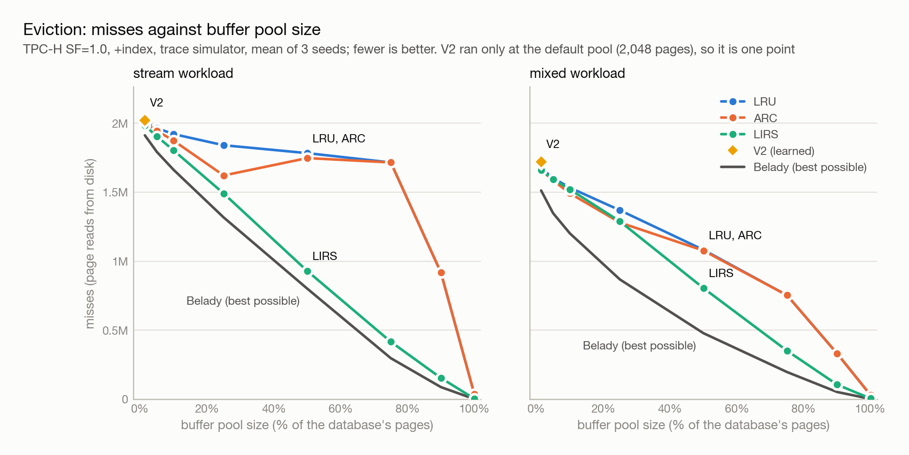
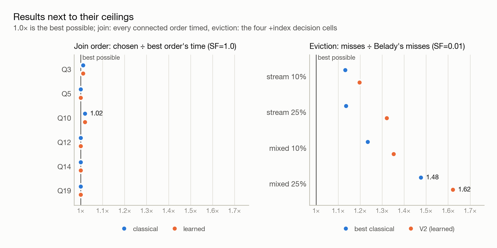
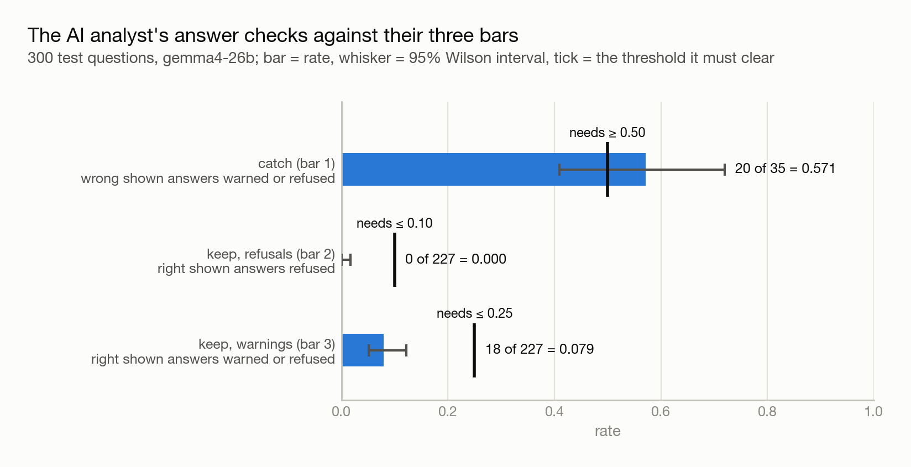

# Research Results

ShilmanDB has two learned components: a join order model and an eviction policy. They were measured against strong classical answers and lost or tied, so they stay in the code as research results, off by default. This page gives those results, the classical eviction policies against the best possible one, and the check behind the AI analyst, where the database checks a model's answers.

Every result here is from today's single-threaded row-store engine, before the columnar core.

Numbers are marked by how we know them: *measured* (we ran it), *from docs* (copied from project notes) or *inferred* (worked out from other numbers). How each component works inside the engine is in [architecture.md](architecture.md).

## Summary

| Component | What it was up against | Result |
|---|---|---|
| Learned join order | the classical planner (cost formula + full search) | ties at best: 1.00-1.02× of the fastest order, the same as classical |
| Learned eviction V2 | LRU | no misses saved; queries 3.5-6.9× slower at SF=0.01 |
| Best classical eviction | Belady (the best possible, needs the future) | 1.07-1.50× Belady's misses on the four cells that matter, SF=1.0 |
| AI-analyst checks | three bars fixed before any result | GO: warned on 20 of 35 silent wrong answers, refused 0 of 227 right ones |

All four rows are *measured*; the sections below give the dates and how.

## Both learned components stay in, off by default

- They are built only with `-DSHILMANDB_ENABLE_ML=ON`, which links LibTorch. Without it the engine builds and passes its tests with no ML code at all.
- With an ML build they are still off unless asked for: `load_tpch --use-learned-join` and `--use-learned-eviction`.
- The models are trained in Python (`ml/join_optimizer/`, `ml/eviction_policy/`) and loaded as TorchScript. The trained `.pt` files are not checked in, because a TorchScript model only loads with the LibTorch version it was saved with.

## The learned join optimizer

**What it does.** A small neural network reads 48 numbers about the query's tables (3 statistics per table and 2 per pair of tables) and proposes a join order. The planner still runs its classical search every time, as a safety check. If the model's order is not connected by the query's joins, or its estimated cost is more than 1.5× the classical best, the planner uses the classical order.

It can only act on joins written as `JOIN ... ON`. Four of the six join queries (Q10, Q12, Q14, Q19) write their joins in `WHERE`, so the model's order is always rejected for them, and only Q3 and Q5 can use it (*from docs*, from reading the planner).

**What happened, in order:**

1. **A win that looked real (2026-10-29).** On Q5 the model's order ran 1.8× faster than the classical one: 4,249.1 ms against 7,722.6 ms at SF=1.0 (*measured*, every connected order timed). The classical formula ignored Q5's date filter, so it couldn't see that joining `orders` early shrinks every step after it.
2. **It was luck (2026-10-29).** Q5 was planned with its five tables written in each of the 16 valid orders. The model found the fast order only when the query already started with `customer` and `orders` (in either order), the way TPC-H writes it. At SF=1.0 it picked the fastest order for 2 of the 16. Averaged over all 16, it was about as fast as classical (7,461 ms against 7,723 ms), and at worst it was 1.59× slower (12,261 ms). *measured* The model mostly echoes the table order it is given; it never saw Q5's order in training.
3. **The classical planner caught up (2026-10-30).** The classical cost formula was changed to see filters, using min/max statistics (no ML involved). After that the classical planner picks Q5's fastest order itself (1.00× of the best at SF=1.0, 1.01× at SF=0.1), and the model picks the same order. *measured* The learned-against-classical gap on Q5 is gone.

**Where it stands (chart 4, join part).** On 2026-11-01, every connected join order of the six join queries was timed at SF=1.0, and each planner's pick was compared with the fastest. Both planners land at 1.00× on Q5, Q12, Q14 and Q19, 1.01× on Q3 and 1.02× on Q10, and they pick the same order every time (*measured*). There is little left to win on join order in these queries, and the model doesn't win it.

## Learned eviction V2

**What it does.** When the buffer pool is full and needs a frame, V2 scores every page it could evict from 4 numbers: time since its last use, how often it was used, time since its use before that, and a dirty flag. A small network predicts which page will be needed furthest in the future, and V2 evicts that one.

**What happened** (2026-11-01, SF=0.01, 128-frame pool, no indexes, each query timed on its own; *measured*):

| | Result |
|---|---|
| Misses against LRU | the same on Q1 and Q6; 4 to 14 more on the six join queries (+0.3% to +1.0%) |
| Time per eviction | 16.6-17.4 µs |
| Query time against LRU | 3.5× (Q19) to 6.9× (Q14) slower |

One eviction costs as much as about 30 page reads from the file cache (*inferred*, arithmetic), so to break even V2 would have to save many misses per decision. It saves none. In single queries there is nothing to save: each query reads each page once per run. Across pool sizes from 128 to 2,048 frames, a decision costs about 17-183 µs (*from docs*, the architecture page).

On a query stream with reuse (chart 3, SF=1.0, the default 1.4% pool), V2 misses 0.8% more than LRU on `stream` and 2.8% more on `mixed` (*measured*, one seed against LRU's mean of three).

## Classical eviction against Belady

**Belady** is the policy that evicts the page whose next use is furthest away. It needs to know the future, so no real system can run it, but replaying a recorded trace through it gives the fewest misses possible. It is the ceiling any eviction policy, learned or not, is measured against.

The engine has LRU (the default), CLOCK, LRU-2, ARC and LIRS. ARC and LIRS here are the engine's versions, which count a page **visit** once rather than every fetch inside it. Without that, a hash join that reads two inputs in turn looks like it reuses every page.

The tests use two workloads with reuse, on the `+index` config:
- **`stream`:** rounds of the 8 queries, each round in a random order, with random constants.
- **`mixed`:** random queries with short date-range index lookups between them.

<picture>
  <source media="(prefers-color-scheme: dark)" srcset="images/eviction-dark.png">
  
</picture>

**Chart 3** shows misses against pool size at SF=1.0. It is a replay of traces recorded from the engine, and the replay equals the engine exactly: 1,033,648 of 1,033,648 workload items matched over 951 runs at three sizes (*measured*, 2026-11-04). Its classical lines are the mean of 3 seeds. V2 ran only at the default pool, so it is a single point.

- **On `stream`, LIRS is the clear winner.** At a 50% pool it has about half of LRU's misses (-49.8% at SF=1.0, *measured* in the engine). LRU gets almost nothing from a bigger pool until the pool holds `lineitem`, because each round scans it from start to end.
- **On `mixed`, ARC does best at 10-25% pools and LIRS above that**, but both stay well above Belady.

**The four cells that matter** are `stream` and `mixed` at 10% and 25% pools. That is where a learned policy would have to win. Best classical policy ÷ Belady there, *measured* in the engine:

| Size | `stream` 10% | `stream` 25% | `mixed` 10% | `mixed` 25% |
|---|---:|---:|---:|---:|
| SF=1.0 (2026-11-04, seed 1) | 1.071 | 1.104 | 1.270 | 1.495 |
| SF=0.01 (chart 4) | 1.13 | 1.14 | 1.23 | 1.48 |
| V2 at SF=0.01 (chart 4) | 1.20 | 1.32 | 1.35 | 1.62 |

So at SF=1.0 the best classical policy misses 1.07-1.50× what Belady would. Chart 4's eviction part is at SF=0.01, the only size where V2 ran on all four cells. There V2 is worse than the best classical policy on every cell. The room left for a learned policy is on `mixed`, where the best classical policy is 1.23-1.50× Belady at both sizes.

<picture>
  <source media="(prefers-color-scheme: dark)" srcset="images/ceilings-dark.png">
  
</picture>

**Chart 4** puts each result next to its ceiling. The join part is SF=1.0 (2026-11-01, the planner as of that date): chosen order ÷ fastest order. The eviction part is SF=0.01: misses ÷ Belady's.

**Two later checks, both no-go** (2026-11-10, replays only, SF=0.1; *measured*):
- **A new learned policy (V3).** Eight model designs, small to large networks and gradient-boosted trees, given basic or richer page features. The bar, fixed in advance, was 5% fewer misses than the better of ARC and LIRS on `mixed` at both 10% and 25% pools. The best design beat them by 7.3% at 25% but only 1.8% at 10%, so V3 was not built.
- **Switching between classical policies** as the workload changes. Even with perfect hindsight, switching saved at most 2.55% of misses, against a 5% bar.

## The AI-analyst check

**What it is.** A local language model (`gemma4-26b`, run on the Mac through MLX) turns a plain-English question into SQL, and ShilmanDB runs it. In the check, the database then tested each answer with evidence only it has, such as the rows each step of the plan kept. The check recorded that evidence next to each answer and labeled the answer warned or refused when something looked wrong. The question was whether these checks catch enough wrong answers without crying wolf on right ones. The bars were fixed before any model answered a test question. A first slice of the app (built 2026-11-15 to 2026-11-16) now shows this to a user: it runs the tested setup (the same model, prompts and checks) and quotes the rates below only while that setup still holds. A replay of the 300 test questions through the app, with its prompt cache on, gave the same model output on all 300 (*measured*).

**The checks:**

| Check | What it looks for |
|---|---|
| second phrasing | asks the question again in other words and warns if the two answers differ |
| terms | a business term read a different way than the question implies |
| empty input | an empty result, or a total over a plan step that kept no rows |
| fan-out | a sum, average or count over rows that the joins repeat |
| engine traps | SQL today's engine runs wrong (for example `LEFT JOIN`, which runs as an inner join); refused |
| grain | result rows that repeat on the grouping columns, or grouping that doesn't match what was asked |
| integer division | a division that drops the fraction |

Engine traps, empty input, fan-out and grain are the **engine's own checks**: they read the plan and the rows each step kept.

**The test** (2026-11-14, *measured*): 300 questions, 150 on TPC-H (SF=0.1) and 150 on a 70,000-row reviews table. Separate AI writers wrote them, and none of them ever saw the checks.
- The model got 252 of 300 right (0.840).
- It showed 262 answers: 227 right and 35 wrong.
- It said "can't answer" 37 times, 25 of them correctly, on the 30 questions that can't be answered.

<picture>
  <source media="(prefers-color-scheme: dark)" srcset="images/analyst-dark.png">
  
</picture>

**The three bars** (chart 5; *measured*):

| Bar | Count | Rate | 95% Wilson interval | Needs | Holds |
|---|---:|---:|---|---|---|
| 1. Catch: wrong answers warned or refused | 20 of 35 | 0.571 | 0.409-0.720 | at least 0.50 | yes |
| 2. Keep: right answers refused | 0 of 227 | 0.000 | 0.000-0.017 | at most 0.10 | yes |
| 3. Keep: right answers warned or refused | 18 of 227 | 0.079 | 0.051-0.122 | at most 0.25 | yes |

The result is **GO**. Wrong answers a user would have trusted with no warning dropped from 35 to 15, and no right answer was refused.

**What carries it** (*measured*):

| Checks counted | Wrong answers caught | Bar 1 (at least 0.50) |
|---|---:|---|
| all of them | 20 of 35 (0.571) | passes |
| all but second phrasing | 9 of 35 (0.257) | fails |
| second phrasing alone | 15 of 35 (0.429) | fails |
| the engine's own checks alone | 5 of 35 (0.143) | fails |
| second phrasing and terms | 18 of 35 (0.514) | passes |
| all but terms | 17 of 35 (0.486) | fails |

**Said honestly, the GO is mostly "ask twice."** The second phrasing makes 15 of the 20 catches. Asking twice and comparing is a known technique. The engine's own checks catch 5 on their own, but only 2 that second phrasing and terms both missed, and only 1 that no other check made (fan-out). The terms check makes 3 catches no other check made, and without it the count falls to 17, which fails. Second phrasing and terms together reach 18, just enough to pass.

**The margin is thin.** At 17 of 35, bar 1 fails. The Wilson interval's low end (0.409) is under 0.50; the rule fixed in advance lets the point value decide.

**Where the misses are.** Top-N answers are where the checks miss most: 6 of 13 caught, and they are 7 of the 15 wrong answers still silent. No check yet compares a ranking or its cutoff with anything. All 35 wrong answers were the model's mistakes; none came from an engine bug.

Each question took a median of 5.3 s, for the first answer plus the rephrased one (*measured*).

## How these were measured

- **Join orders:** a tool that times every connected join order of a query, 1 warmup + 5 runs, median.
- **Eviction:** engine traces replayed through every policy and Belady at pools from 5% to 100% of the database, with misses counted per workload item. The classical policies were then built into the engine and matched against the replay item by item.
- **V2's cost:** the buffer pool's policy timer, which times every call the pool makes to the policy.
- **The analyst:** a frozen model, frozen checks and a frozen question set. Questions were split into a set for tuning the checks and a test set that was run once.

The chart data is in [docs/data/eviction_misses.csv](data/eviction_misses.csv), [ceilings.csv](data/ceilings.csv) and [analyst_bars.csv](data/analyst_bars.csv). [bench/charts/make_charts.py](../bench/charts/make_charts.py) redraws the charts from them.
